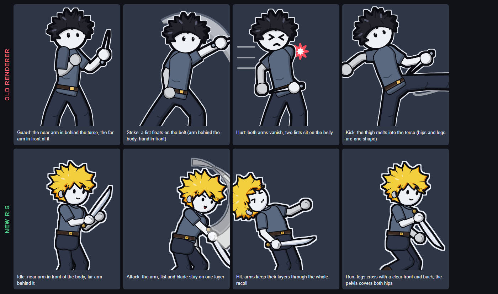

# Character system v3: the canonical rig

Started 2026-11-20. It replaces the way characters are built and animated. The old renderer (`js/avatar.js`) stays in the game until the integration step (phase 6). The new system lives in its own files and is checked in the **Rig Lab** (`rig.html`).

| Phase | State |
| --- | --- |
| 1. Audit | Done (below) |
| 2. Canonical model | Done: `js/rig-canon.js` |
| 3. Rig and animations | Done: `js/rig.js`, `js/rig-anims.js` (idle, run, attack, hit, death) |
| 4. Hair production | Done. The user's choice: **the 36 original haircuts are the assets** (clean transparent pictures, `assets/hair/`), placed on the skull and fitted to each head at run time (`js/hair-cuts.js`); in the game as locked cosmetics (dev tool). The procedural recipe (`js/rig-hair.js`) stays as one more cut |
| 5. Validation prototype | Automated checks and the Rig Lab done (`js/rig-check.js`, `rig.html`). Assets so far: 37 hairstyles, 1 outfit, 1 weapon, 1 face. Still to make: 2 outfits, 1 weapon, 1 face |
| 6. Integration | Not started (plan and open questions at the end) |

## 1. Audit of the old renderer

The old renderer is `js/avatar.js` (with `js/hair2.js` for the v2 haircuts and `js/custom.js` for Studio content). Every frame, `drawAvatar()` builds the whole figure as one SVG string and replaces `innerHTML` (about 30 fps). It does this for each `svg.avatar` on screen: the player, humanoid foes, scenes, portraits and cosmetic cards.

**There is no Three.js in the project.** The combat view (`js/arena.js`) is DOM and SVG. It calls `avatarSVG()` and `avPlay()`, and the engine sends `on('hit')` / `on('kill')` events. "Preserve the combat system" therefore means keeping those call sites and events unchanged.

### What was wrong, and why

The problems are architectural. A better prompt would not fix any of them.

1. **No attachments.** Body parts are not assets bound to bones. Each frame recomputes all geometry from joint positions: limbs are tubes along curves, the torso is a (u, v) map. No part has a defined shape, pivot or overlap zone, so a joint looks right only by accident.
2. **Depth is guessed every frame.** `crossing()` decides each frame whether an arm goes behind the torso or over the head, from where its hand is. The pose flags `bf` / `ff` force it. Hands are drawn on a separate layer from their arm. As a result:
   - in `guard` (the combat idle) the **near arm is drawn behind the torso and the far arm in front of it**;
   - layers swap partway through transitions (`guard → hurt` swaps at 60 % and again at 100 %);
   - **fists float on the belly** with their arm hidden behind the body.
3. **The body is not a hierarchy.** The upper arm and thigh angles are absolute (world), not relative to the chest or pelvis. When the torso leans, the limbs do not follow. Poses are blended as raw numbers with no shortest-path rule, so a foot going from `fB: -190` to `-16` spins through 174°.
4. **Hips and both legs are one merged shape** (skin, and trousers again on top). A raised or crossing leg cannot pass in front of the other leg or the torso. In a kick the thigh melts into the torso, and the `legEdge` lines are a patch over this.
5. **The proportions are not canonical.** Bone lengths are written in several places (`solve()`, `plantPose()`: 23, 21, 36, 35, 69.5…). The "build" cosmetic (`slim`, `stout`, `tall`) scales the skeleton itself, and the head radius changes with it while head art assumes 19.
6. **There is no head reference.** Conventions (radius 19, eyes near y 2, a face shifted by `-3.7·(1-tw)`) exist only in comments. Hair v1 is a cap plus random locks. Hair v2 is random part generators with seeded jitter, and the 20 manga cuts are freehand strokes. Nothing defines a hairline, a crown or a growth direction, and nothing checks coverage or alignment. Every cut is a new drawing, which is why geometry and silhouettes are inconsistent.
7. **No run or death animation.** Death is a CSS rotation of the whole SVG (`foeDown`), and running is a CSS `translateX` (`lunge`). Motion comes from four unrelated sources: `POSES`, `POSE_DRIVE` functions, `avPlay` sequences and CSS keyframes.

## 2. Spine 2D: evaluated, not adopted as a dependency

Spine's model is exactly what was missing: bones, slots with a draw order, skins of attachments, IK, and animations with draw-order keys and events. Using the Spine *runtime* does not fit this project:

- **Licence.** Shipping the Spine Runtimes requires a paid Spine Editor licence. Meshes and IK are Professional-tier features, and businesses over $500k a year need Enterprise. The Runtimes licence also says a product must **not substitute for the Spine Editor in creating or editing skeletons or animations**. That is exactly what the Studio (`editor.html`) does.
- **Workflow.** Spine content is made by hand in its GUI editor from raster images. Here, characters and cosmetics are produced as data, by code and by the Studio.
- **Rendering.** The runtimes draw textured meshes (canvas or WebGL). The avatars are vector SVG, recoloured live (skin colour, dyes, hair palettes), drawn in four ink styles, and shown as dozens of small SVG strings at once (cosmetic cards, portraits, scenes).

**Decision.** Spine's data model is implemented in a small SVG runtime (`js/rig.js`, no dependency, one global `RIG`). The data uses Spine's concepts one for one: bones with local transforms, slots in draw order, skins, IK constraints, animation timelines (rotate, translate, attachment, draw order, events). Moving to Spine later would be an export job, not a rewrite.

## 3. The canonical model (`js/rig-canon.js`)

**View.** A 3/4 front view, facing right. The character's right side is nearest and sits on the **left** of the picture (suffix `N`, near). Its left side is on the right, partly behind the body and drawn 12 % darker (suffix `F`, far). The ground is y = 0 and y points down. One unit is about one pixel of the 156 × 218 avatar box.

| | |
| --- | --- |
| Height | 171.6 units = 4.52 heads |
| Skull | radius 19, the frame of every head asset (origin at the skull centre) |
| Spine | pelvis → waist 24 → neck base 28 → neck top 6 → skull centre 17 |
| Arm | upper arm 23, forearm 21, hand 4.2 (wrist to the grip, the centre of the fist) |
| Leg | thigh 36, shin 35, foot 12; ankle 4.6 above the sole |
| Joints | shoulders at x −12 / 11.5, 7 under the neck base; hips at x −6.5 / 5.5, 2 under the pelvis centre |
| Radii | arm 4.6 → 4.3 → 3.9, leg 6.6 → 5.6 → 4.6 (equal on both sides of each joint) |
| Torso | one width profile (`RIG_TORSO`) for the pelvis, belly and chest pieces and every garment on them |
| Line | 1.2 units for every asset, plus the sticker rim around the figure |
| Light | upper left; one cel shadow, cut from each ink group as a whole |

**Skeleton.** 24 bones: root, hip, torso, chest, neck, head, skull, hairBack (spring), arms (upper, fore, hand, grip) and legs (thigh, shin, foot) on both sides, plus two IK foot targets.

**Draw order.** 42 slots in 27 ink groups, back to front:

> back hair, back items, far arm (skin, sleeve, weapon, fist), far leg, near leg, body (pelvis, belly, chest, neck), trousers, top, belt, collar, head, the fringe's shadow, face, hair (scalp, sides, bangs, strands), hat, near arm (skin, sleeve, weapon, fist), effects

**Named points.** `skull`, `sternum`, `nape`, `backMount`, `belt`, `sheath`, `gripN`, `gripF`.

**Rules for every cosmetic:**

- A cosmetic is a **skin**: attachments plus colours, drawn in the frame of a bone. It never brings bones, lengths or scales, and the checks reject one that tries.
- Feet and shoes fit the **foot box** (heel −9, toe 12, sole at 4.6).
- Garments sit at most 2.8 units over the body. Full-length trousers stop 3.5 above the ankle; the shoe covers the rest.
- Outfits come from a recipe (`rigOutfit`: sleeve length, hem, fit, collar, trouser length, flare, belt, shoe), so they always fit the body the same way.
- Faces provide five expressions on fixed anchors: near eye (−0.5, −0.4), far eye (13.3, −0.4), mouth (5.9, 10). The expressions are neutral, angry, hurt, dead and happy. These anchors were measured on the user's reference sheet (25 heads); the first version had the eyes lower and closer.
- The **near ear** belongs to the head (centre (−20.8, 5.3), measured on the sheet). Its inner edge follows the skull, so it only sticks out of the head. It is drawn over the hair; a cut that covers the ears hides it (`ears: false`).
- Weapons are parts along +x from the grip. The fist is drawn over the handle.

The old "build" cosmetic, which scaled the skeleton, has no equivalent. That is a deliberate consequence of the brief.

## 4. Rig and animation architecture (`js/rig.js`, `js/rig-anims.js`)

- **Pose.** Local transforms (setup plus animation offsets) become world transforms, parents first. Bones are a point and an angle: no scale, no shear.
- **IK.** Two-bone, analytic, with knees bending forward. The foot copies its target's angle. Legs are never posed directly.
- **Springs.** The back hair trails behind moves on a damped spring. A swing that would go through the floor is cut back, so the hair squashes instead.
- **Ink groups.** Consecutive slots in one group share one outline pass: all outlines, then all fills, then the cel shadow cut from the whole group. A limb made of two bones bends without a seam, and the torso pieces read as one body.
- **Animation state.** It crossfades from whatever is on screen (shortest-path rotations), queues the next animation (a one-shot returns to the loop), and fires events. The attack fires `impact` and the run fires `step`.
- **Authoring.** Animations are written pose to pose: key poses on a timeline, compiled to one timeline per bone. Values are offsets from the A-pose. Only the hip and the foot targets may translate. `rigFoot()` and `rigGroundFeet()` keep a turning foot above the floor between keys.

| Animation | Length | What happens |
| --- | --- | --- |
| idle | 2.2 s loop | Breathing in the guard stance. |
| run | 0.66 s loop | Two steps. Feet slide back at a steady speed while planted, with flight phases, a body bob and counter-swinging arms. |
| attack | 0.64 s | 0.16 s anticipation, then the blade passes **behind the head** (a named draw-order key). 0.065 s strike with `impact` and a slash trail, a held follow-through, then back to the stance. |
| hit | 0.44 s | The head snaps back and the body recoils over planted feet, then recovers. |
| death | 1.4 s, holds | Recoil, the knees give, the body tips back and falls flat, a small bounce, still. |

## 5. Hair production (`js/rig-hair.js`)

**Target (2026-11-20).** The user sent a reference sheet of 36 manga haircuts drawn on this avatar's head (6 worlds × 6 cuts). It is the visual target. It stays out of the public repo; the measurements live in the recipes.

**How a cut is matched to the sheet.** For each cell, the head circle is fitted on the chin and cheek arc (RANSAC: 37.3 px for r 19, so 1.97 px per unit). Our portrait is then rendered at that exact scale and position, and two numbers are compared: the overlap of the head-and-hair silhouettes (above the chin) and the overlap of the visible face (where the bangs and side locks end). Tips, valleys and the fringe's lower edge are measured in head units, on the black outline (the white rim fills narrow valleys). The reference cut scores **silhouette 96 %, face 90 %**.

- **Head reference (`RIG_HEAD`, version 2: the measured face, the ear, the hairline centred on that face).** Every hairstyle is built on it: the skull (r 19), eye boxes, the hairline, the sideburns, temple roots, the nape line and the crown (whorl). These define the **scalp region** (where hair grows) and a **growth field**. In `fall` mode hair leaves the crown and gravity pulls it down (bangs, side locks, long hair). In `stand` mode it leaves straight out of the skull (spikes, tufts).
- **Authored edges (version 2).** The sheet's cuts are big masses, not thin locks. So the scalp's outer edge can be written directly as tips and valleys around the skull (`edge: [[angle, radius, 't' | 'v']]`); each side of a spike is hollowed slightly. The back mass is written the same way (`backEdge`), and the fringe's lower edge over the face as a zigzag (`fringe: [[x, y, 't' | 'v']]`) whose top always starts on the canonical hairline. A lock can also be placed by the point its tip reaches (`to: [x, y]`). The scalp is still closed exactly on the canonical hairline, sideburn and nape, and every check still applies (spikes 4–36 wide at the base, standing out of their valleys; bangs hanging below their gaps).
- **A hairstyle is a recipe, not a drawing.** It has a colour, a volume (or an authored edge) and five layers:
  - back mass: behind the head and the body, darker, on its spring;
  - scalp: the volume over the skull, **cut exactly on the canonical hairline**, with the crown spikes;
  - side locks;
  - bangs;
  - strands (optional).
- **Locks.** Each lock is anchored to a landmark (`['hairline', u]`, `['skull', angle]`, `['temple', 'N']`, `['nape', u]`, `['crown']`). It leaves along the growth direction there, give or take a turn. It is a tapered ribbon with a root width, a belly and a tip (point, round or blunt).
- **One set of drawing rules, matching the sheet:**
  - one black outline around the whole mass, the body's line (the scalp merges into the back mass); where hair lies on the face the line is as heavy as the silhouette's;
  - every lock cel-shaded like the body (one light, upper left);
  - thin tapered black lines along lock edges and from each valley into the mass;
  - gloss streaks on the upper left; no cast shadow on the forehead.
- **Colours.** The palette comes from one base colour, so any dye works. Shadows move away from yellow: warm hair shades towards red (yellow → orange), cool hair towards blue-violet.
- **Hair is soft.** Where it would pass through the floor (a body lying down) it is pressed flat on it.
- **The reference cut, "Leaf Spikes"** (the sheet's Naruto cut, world 1). An authored edge with 8 spikes, 3 darker spikes behind the head, a measured fringe (a bang left of the near eye, the forehead showing above it, a long bang sloping to between the eyes, two small ones), a side lock in front of the ear and one past the far temple. The Lab shows it layer by layer and in seven colours.

### The 36 haircuts as pictures, fitted at run time (2026-11-20, the user's decision)

Instead of redrawing each cut as a recipe, the user wanted the original cuts as assets. They then supplied the 36 cuts as **clean transparent cut-outs**, which replace the first cut-outs made from the sheet. All of it lives in `js/hair-cuts.js`, which the game's avatar and the rig share:

- **Placement (done once, offline).** Each clean cut was registered (scale + offset) on the same cut in the reference sheet, where the head is known. Silhouettes above the chin overlap 81–95 %. A cut stores only its box in skull units (`x, y, w, h`), `reach` (its farthest visible hair), `ear` (false when it covers the ear) and `covers` (an eye it hides on purpose: Cook's Curtain hides the far eye). The pictures (`assets/hair/<id>.png`, about 250 KB for all 36) had their edges cleaned of the matting's colour halos.
- **Fitting (dynamic, `HAIR_FIT`).** A picture drawn for one face does not sit right on every head, so it is morphed for the head that wears it. A head is a "spec" (where its face midline and its eyes are), and the morph runs once per cut and spec, in a canvas, giving an image URL:
  1. *turn*: the face opening slides to that head's face; the sheet's faces are turned 3/4, the game's avatar less. The skull's edges stay put;
  2. *lift*: a fringe that would fall on an eye is lifted above it. The forehead hair is compressed and the silhouette stays;
  3. *cover*: hair that stops just short of the skull's rim (a sliver of bald outline) is pulled onto it. A gap wider than 5 units is the cut's design and is left alone;
  4. *eyes*: whatever still lies on an eye is cleared, so every expression shows (except an eye the cut hides).

  Specs: `rig` (the rig's face) and `av0` / `av0.5` / `av1`, the game's avatar facing us, half turned and 3/4 in combat. The avatar picks the nearest spec for its current turn. Until a morph is ready, or where the page cannot read pixels (`file://`), the plain picture is drawn.
- **In the game.** The 36 cuts are hair cosmetics `cut_<id>`. They are locked: how they are earned is not decided yet, and the dev tool's "unlock every look" makes them wearable. The avatar draws the fitted picture over its head and face.
- **Limits.** No dyes (the colours are the pictures'); one layer seen from the front (no back hair on a spring); a hat that covers the head does not flatten the picture.

**Hair checks for a picture** (`rigHairImageCheck`, measured on the picture *after* it is fitted to the rig's head): attached to the skull, in the hair slot only; fitted (the Lab must be opened over http for that); each eye clear (≤ 3 % covered) or hidden whole by design (≥ 85 %); the face's core at most 40 % covered (+15 % per hidden eye); the scalp at least 60 % and its rim at least 85 % under hair; visible hair within 3.2 skull radii; and every picture file loads.

## 6. Validation (`js/rig-check.js`, `rig.html`)

The Rig Lab shows:

- the canonical model, with skeleton, ink-group and head-unit overlays;
- a live player with pickers for every cosmetic and combat buttons;
- filmstrips of every animation;
- every haircut, grouped by world: click one to wear it. The selected cut is shown alone (with its box, the skull and the eye boxes), on the rig, with the four other expressions, and lying on the floor at the end of the death animation;
- the head reference;
- the check report.

The checks run on **every combination of cosmetics, every animation, frame by frame**, plus crossfades between animations:

| Group | Checks |
| --- | --- |
| Canonical model | bone lengths and joints match `RIG_CANON` |
| Draw order | canonical order; near limbs in front and far limbs behind in every frame; a hand never on another layer than its arm |
| Joints | child joints at the end of their parent; feet reach their IK targets; no gap around any joint, on skin and on clothes (the joint and the first part of both bones) |
| Intersections | the torso never covers a leg; nothing goes below the floor |
| Attachments | no missing attachment (body slots, every expression the animations use, whole garments); cosmetics never touch the skeleton; attachments drawn in their bone's frame; feet and shoes in the foot box |
| Animations | only rotations (translation on the hip and foot targets only); no pops between frames; loops close; planted feet do not skate; one-shots end in the idle pose; death ends flat on the floor; the attack fires `impact`; crossfades stay clean |
| Hair | for a recipe: the five layers; built on head reference v2, in the hair slots only; no bald spot; the scalp follows the canonical hairline; eyes clear; roots on the scalp and directions along the flow; widths in range and tapering; silhouette in bounds; in motion, every back tuft stays rooted. For a cut-out: the checks listed in section 5 |

**Self-test.** The checks are only worth something if they catch real faults, so the Lab breaks the rig on purpose, one fault at a time, and expects the matching check to fail. The faults include:

- both old renderer bugs (a hand on another layer, the near arm behind the body);
- a limb moved off its joint, a gap at the elbow, a knee pulled into the torso, a foot through the floor;
- a 300° key and a loop that does not close;
- a cosmetic with its own bones, an oversized shoe, a missing expression;
- a hairstyle that is misaligned, bald, covers the eyes, roots a lock off the scalp, grows a bang against the flow, has a lock that is too wide, or targets another head;
- a picture whose fringe stays on an eye, that half hides the eye it is meant to hide, that slides off the scalp, that leaves the skull's outline showing, or that could not be fitted.

The hair rides the skull and plays no part in the body's checks, so the Lab plays every body combination (outfit × weapon × face) with one cut, and every other cut with one dressed body. It runs in steps, so the page stays live.

**Result on 2026-11-20 (37 cuts, fitted):** **2570/2570 checks pass** (40 combinations × 5 animations, 6600 frames), and the self-test catches **27/27 faults**.

## 7. Adding content (the pipeline)

- **Hairstyle from a picture.** A clean transparent cut of the hair alone, drawn for the canonical head. Add an entry to `HAIR_CUTS` with its box in skull units. `HAIR_FIT` fits it to every head, and the hair checks gate the fitted result.
- **Hairstyle as a recipe.** Write a recipe in `RIG_HAIR_DEFS` (an authored edge, fringe and back edge measured on its reference cell, plus landmark-anchored locks), compile it with `rigHairstyle()`, and register it in `RIG_HAIRS`. Compare it with its reference at the same scale until both overlaps are high. The Lab draws it on the head reference and adds it to every combination; the hair checks gate it.
- **Outfit.** Write a `rigOutfit({...})` recipe in `RIG_OUTFITS`.
- **Weapon.** Use `rigWeapon(id, name, parts)` along +x from the grip.
- **Face.** Use `rigFace(id, name, { neutral, angry, hurt, dead, happy })` on the shared anchors.
- **Animation.** Write key poses with `rigAnim()`: rotations, hip and foot targets, and `rigFoot()` for a turned foot. Draw-order changes are allowed only as named ink-group keys.

Nothing ships unless the Lab shows every check passing.

## 8. Integration plan (phase 6, after validation)

- **Module.** A small adapter (`js/rig-avatar.js`) makes `avatarSVG()` and the animation loop draw with `RIG` when the new system is on. `arena.js` stays as it is.
  - `on('hit')` maps to `attack` / `hit`, `on('kill')` maps to `death` (replacing the CSS fall), and fighting idle maps to `idle`.
  - A character carries `{ hair, outfit, weapon, face, colours }` as data (skins).
- **Decisions needed before switching:**
  - Builds (slim / stout / tall) are cosmetics that rescale the skeleton. They must go, or become body-shape skins on the same bones.
  - The four ink styles (flat, ink, neon, sketch) need porting.
  - The skill scenes use their own driven motion: fishing, cooking and woodcutting (`POSE_DRIVE`, IK on rods, pans and axes). These must be rebuilt as rig animations, or keep the old renderer for scenes.
  - The existing cosmetics have to be ported to the new rig: 18 tops / bottoms, 12 hats, 15 faces, 10 back items and 9 auras (the 36 sheet cuts can replace the old haircuts). Hats need a "covers" rule for hair layers.
  - Whether the 36 cuts become world cosmetics (one row of the sheet per world), and how they are unlocked.
  - Death needs room: a body lying flat is about 170 units wide, more than the 156-wide avatar box.
- **Performance.** The same immediate SVG rebuild as today. Later, attachment paths can be cached per skin and only transforms updated.
